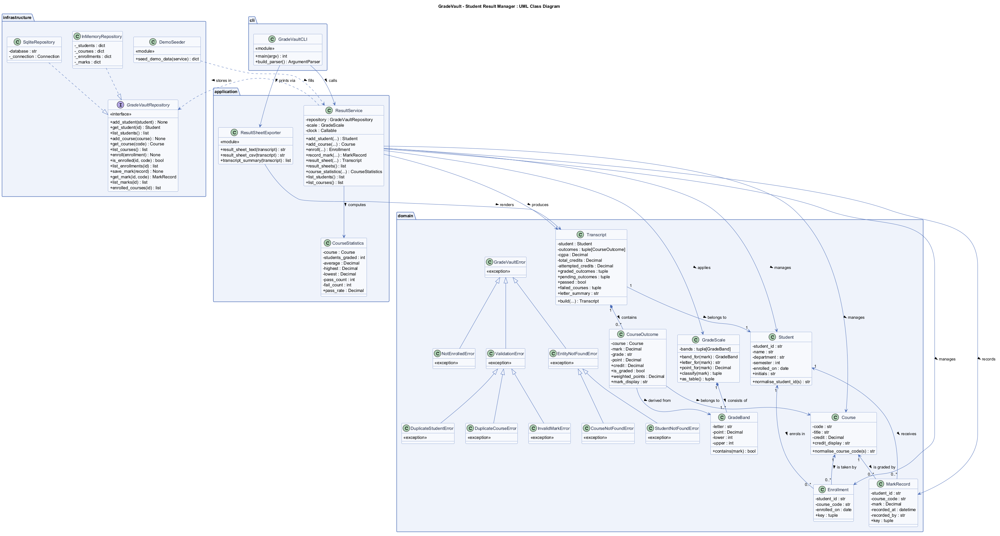

<div align="center">

# GradeVault

### Student Result Manager — CSE402 Software Engineering

Record students' marks, turn them into letter grades and grade points, and
produce a credit-weighted CGPA and a printable result sheet.

`Python 3.10+` · `No runtime dependencies` · `254 automated tests` · `91% coverage`

[](https://github.com/Soron666/gradevault/actions/workflows/ci.yml)
[](https://www.python.org/)
[](LICENSE)

</div>

---

## Table of contents

1. [What it does](#what-it-does)
2. [The UML class diagram](#the-uml-class-diagram)
3. [Quick start](#quick-start)
4. [Command reference](#command-reference)
5. [A sample result sheet](#a-sample-result-sheet)
6. [The grading scale and the CGPA formula](#the-grading-scale-and-the-cgpa-formula)
7. [Testing](#testing)
8. [Project structure](#project-structure)
9. [Design decisions](#design-decisions)
10. [The team](#the-team)

---

## What it does

GradeVault is a command line application for a teacher who needs to keep marks
and turn them into results. It covers every functional requirement of the
CSE402 brief:

| # | Requirement (from the brief) | Where it lives | Covered by |
|---|---|---|---|
| 1 | Add a student with an ID and a name; **IDs must be unique** | `ResultService.add_student`, `Student`, `InMemoryRepository.add_student`, `SqliteRepository.add_student` | `tests/test_service.py::test_student_ids_are_unique` |
| 2 | Add a course with a code, a title and a credit value | `ResultService.add_course`, `Course` | `tests/test_service.py::test_a_course_can_be_added` |
| 3 | Enter marks out of 100; **reject anything below 0 or above 100** | `ResultService.record_mark`, `normalise_mark` | `tests/test_service.py::test_a_mark_outside_the_range_is_rejected` |
| 4 | Calculate the letter grade and the grade point | `GradeScale`, `GradeBand` | `tests/test_grading.py` (22 cases over the whole table) |
| 5 | Calculate a CGPA **weighted by course credits** | `Transcript.build`, `CourseOutcome.weighted_points` | `tests/test_cgpa.py` |
| 6 | Show a result sheet listing course, mark, grade, grade point and CGPA | `Transcript`, `result_sheet_text`, `result_sheet_csv` | `tests/test_export.py`, `tests/test_cli.py` |

Beyond the brief, GradeVault also keeps an audit trail (who entered a mark and
when), reports per-course statistics, exports a result sheet to CSV, and
survives a restart because everything is stored in a SQLite file.

## The UML class diagram

The class diagram is a required deliverable and it is part of the repository:

| File | What it is |
|---|---|
| [`docs/uml-class-diagram.png`](docs/uml-class-diagram.png) | The rendered diagram (3208 × 1722 px) |
| [`docs/uml-class-diagram.svg`](docs/uml-class-diagram.svg) | The same diagram as vector art |
| [`docs/uml-class-diagram.puml`](docs/uml-class-diagram.puml) | The PlantUML **source** — edit this, re-render the rest |
| [`docs/uml-class-diagram.md`](docs/uml-class-diagram.md) | A written walk-through of every class and relationship |



Re-render it with `java -jar plantuml.jar docs/uml-class-diagram.puml`, or
paste the `.puml` file into <https://www.plantuml.com/plantuml/uml/>.

## Quick start

**No installation is needed** — the project uses only the Python standard
library. From a clone:

```bash
git clone https://github.com/Soron666/gradevault.git
cd gradevault

# Windows
$env:PYTHONPATH = "src"
# macOS / Linux
export PYTHONPATH=src

python -m gradevault demo          # load a demonstration dataset
python -m gradevault result --student 241337037
```

Or install it as a proper package, which also puts a `gradevault` command on
your PATH:

```bash
pip install -e .
gradevault demo
gradevault result --student 241337037
```

## Command reference

```
gradevault [--db PATH | --memory] COMMAND

  student add --id ID --name NAME [--department D] [--semester N]
  student list
  student show --id ID

  course add --code CODE --title TITLE [--credit C]
  course list

  enroll --student ID --course CODE
  mark enter --student ID --course CODE --mark N [--by NAME]

  result --student ID [--csv] [--out FILE]
  stats [--course CODE]
  scale
  demo
```

A worked example:

```bash
gradevault student add --id 241337037 --name "Md. Ragib Shahriyer Soron" \
    --department "Computer Science & Engineering" --semester 5
gradevault course add --code CSE402 --title "Software Engineering" --credit 3.00
gradevault enroll --student 241337037 --course CSE402
gradevault mark enter --student 241337037 --course CSE402 --mark 86 --by "Prof. Rahman"
gradevault result --student 241337037
gradevault result --student 241337037 --csv --out sheet.csv
```

Every expected failure is reported as a readable message with a non-zero exit
code — no tracebacks for a duplicate ID or an out-of-range mark:

```
$ gradevault mark enter --student 241337037 --course CSE402 --mark 120
error: mark must be between 0 and 100, got 120
$ echo $?
1
```

## A sample result sheet

```
==============================================================================
                             STUDENT RESULT SHEET
==============================================================================
  Student ID         : 241337037
  Name               : Md. Ragib Shahriyer Soron
  Department         : Computer Science & Engineering
  Semester           : 5
  Registered on      : 2026-11-19
  CGPA               : 3.83
  Credits earned     : 13.00
  Credits attempted  : 13.00
  Graded courses     : 4
  Pending courses    : 0
  Grade distribution : A:1  A+:2  A-:1
  Result             : PASS

+-------------------------------------------------------------------+
| Course  | Title                   | Credit | Mark | Grade | Point |
+-------------------------------------------------------------------+
| CSE402  | Software Engineering    |      3 |   86 | A+    |  4.00 |
| CSE403  | Database Systems        |      3 |   78 | A     |  3.75 |
| CSE410  | Artificial Intelligence |      4 |   92 | A+    |  4.00 |
| MATH201 | Discrete Mathematics    |      3 |   71 | A-    |  3.50 |
+-------------------------------------------------------------------+

CGPA (credit-weighted) : 3.83
==============================================================================
```

## The grading scale and the CGPA formula

The scale is exactly the table in the brief:

| Marks | Grade | Point |
|---|---|---|
| 80–100 | A+ | 4.00 |
| 75–79 | A | 3.75 |
| 70–74 | A- | 3.50 |
| 65–69 | B+ | 3.25 |
| 60–64 | B | 3.00 |
| 55–59 | B- | 2.75 |
| 50–54 | C+ | 2.50 |
| 45–49 | C | 2.25 |
| 40–44 | D | 2.00 |
| 0–39 | F | 0.00 |

The CGPA is credit-weighted:

```
CGPA = Σ (grade point × course credit) ÷ Σ (course credit)
```

Worked example — four courses, one of them worth four credits:

```
(4.00 × 3) + (3.75 × 3) + (4.00 × 4) + (3.50 × 3) = 49.75
credits            = 3 + 3 + 4 + 3 = 13
CGPA               = 49.75 ÷ 13 = 3.8269…  →  3.83
```

A plain (unweighted) average of the same four courses would be 3.81 — the
weighting is what makes the number meaningful, and `tests/test_cgpa.py` fails
if it is removed.

## Testing

The brief requires testing code, so the test suite is a first-class part of the
project: **254 tests, 91 % statement coverage**, running in about two seconds.

```bash
pip install -r requirements.txt
python -m pytest                        # the whole suite
python -m pytest --cov=gradevault       # with a coverage report
python -m pytest tests/test_cgpa.py -v  # one file, verbose
```

| Test file | What it covers | Cases |
|---|---|---|
| `tests/test_grading.py` | The whole grading table, band by band and boundary by boundary, plus mark validation | 87 |
| `tests/test_service.py` | The six functional requirements as use cases | 41 |
| `tests/test_cgpa.py` | The credit-weighted CGPA, including a test that fails if the weighting is removed | 16 |
| `tests/test_repository.py` | Both repositories, run against the same tests | 39 |
| `tests/test_cli.py` | The command line end to end, including the error paths | 19 |
| `tests/test_export.py` | The result sheet as text and as CSV | 14 |
| `tests/test_student.py` | The `Student` entity and its validation | 13 |
| `tests/test_course.py` | The `Course` entity and its validation | 25 |

The repository tests are parameterised, so every storage test runs twice — once
against the in-memory repository and once against SQLite. The two
implementations cannot drift apart without a test going red.

## Project structure

```
gradevault/
├── src/gradevault/
│   ├── domain/            # business rules - no I/O at all
│   │   ├── student.py     # the Student entity
│   │   ├── course.py      # the Course entity
│   │   ├── enrollment.py  # the student <-> course link
│   │   ├── assessment.py  # the mark record
│   │   ├── grading.py     # the grading scale and mark validation
│   │   ├── result.py      # CourseOutcome, Transcript, the CGPA
│   │   └── errors.py      # the exception hierarchy
│   ├── application/
│   │   ├── service.py     # ResultService - the use cases
│   │   └── export.py      # the result sheet, as text and as CSV
│   ├── infrastructure/
│   │   ├── repository.py  # the protocol + in-memory + SQLite
│   │   └── seed.py        # the demo dataset
│   ├── cli/
│   │   └── app.py         # the command line front end
│   ├── rendering.py       # the table renderer
│   └── __main__.py        # python -m gradevault
├── tests/                 # 254 tests
├── docs/                  # the UML diagram and its walk-through
├── .github/workflows/     # CI: tests on every push
├── pyproject.toml
├── requirements.txt
└── README.md
```

## Design decisions

A few choices that go beyond "make it work":

1. **`Decimal` everywhere, never `float`.** Grade points and credits are
   `Decimal`, so `(4.00 × 3 + 3.75 × 3) / 6` is exactly `3.875` and not
   `3.8749999999999996`. A CGPA that wobbles in the last decimal place is a
   bug in a marksheet.

2. **The grading scale is data, not code.** `GradeScale` is built from
   `GradeBand` rows and validated at construction: the bands must tile the
   0–100 range with no gap and no overlap. A different departmental scale is a
   different list of rows — no `if` statement has to change. A scale with a hole
   in it is rejected immediately (`tests/test_grading.py`).

3. **A pending course never lowers a CGPA.** Only graded courses enter the
   average. A course that is enrolled in but not yet marked appears on the
   result sheet as *not graded*, so the student can see what is outstanding.

4. **The service depends on an interface, not on SQLite.** `ResultService`
   only ever sees `GradeVaultRepository`. That is why the same 254 tests run
   against the in-memory store and the SQLite file, and why the storage can be
   swapped without touching a single use case.

5. **The domain layer has no I/O.** No file, no database, no printing. That is
   what makes it cheap to test, and it is why the domain tests are the fastest
   and the most numerous.

6. **Expected failures are values, not accidents.** Every error the program
   raises on purpose descends from `GradeVaultError`, so the CLI turns it into
   one clear line and exit code 1 instead of a traceback.

## The team

CSE402 requires a team of three. Each member owns one layer of the project.

| # | Name | ID | Responsibility |
|---|---|---|---|
| 1 | **Md. Ragib Shahriyer Soron** | 241337037 | Project lead — domain layer (entities, grading scale, CGPA), UML class diagram, integration and documentation |
| 2 | **Tamanna Akter** | 241020038 | Application layer (`ResultService`, result-sheet export) and the CLI front end (`gradevault.cli`) |
| 3 | **Konika Tasnim** | 241121037 | Persistence layer (in-memory + SQLite repositories) and the automated test suite |

Each part of the repository is owned end to end: the layer above it is written
against the interface below it, so the three can be developed in parallel
without blocking each other.

## License

MIT — see [LICENSE](LICENSE).
