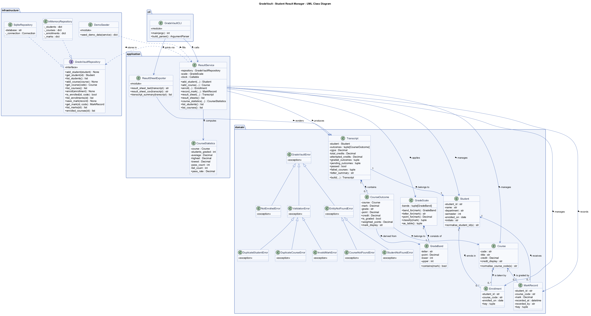

# UML Class Diagram — GradeVault



The diagram above is the class diagram of the GradeVault Student Result Manager.
It is maintained as **PlantUML source** in [`uml-class-diagram.puml`](uml-class-diagram.puml),
so it can be edited as text and re-rendered at any time.

## How to re-render the diagram

```bash
# Option 1 - locally, with the PlantUML jar (Java 8+)
java -jar plantuml.jar docs/uml-class-diagram.puml

# Option 2 - in the browser, with no installation at all
#   open https://www.plantuml.com/plantuml/uml/ and paste the .puml file
```

The repository also ships the pre-rendered `uml-class-diagram.png` and
`uml-class-diagram.svg`, so the diagram is visible without any tooling.

---

## The architecture in one paragraph

GradeVault is a **layered** application. The layers only ever depend on the
layer below them, which is why the domain can be tested with no database and
no files at all.

```
       cli  ──────────────────────────────┐
        │                                  │
        ▼                                  ▼
  application ──────────────► infrastructure
        │                                  │
        ▼                                  │
      domain  ◄────────────────────────────┘
```

| Layer | Package | Responsibility |
|---|---|---|
| Domain | `gradevault.domain` | The business rules: entities, the grading scale, the CGPA formula. Pure Python, no I/O. |
| Application | `gradevault.application` | The use cases (`ResultService`) and the rendering of the result sheet. |
| Infrastructure | `gradevault.infrastructure` | The repositories (in-memory and SQLite) and the demo dataset. |
| CLI | `gradevault.cli` | The command line front end. Parses arguments, calls one use case, prints the result. |

## The classes

### Domain

| Class | What it is |
|---|---|
| `Student` | A registered student: unique ID, name, department, semester, registration date. |
| `Course` | A course: unique code, title, credit value (the weight used in the CGPA). |
| `Enrollment` | The link between a student and a course. A mark may only be recorded for an enrolled pair. |
| `MarkRecord` | One mark on a 0-100 scale, plus who entered it and when. |
| `GradeBand` | One row of the grading table — the marks `lower..upper` earn the letter `letter` and the point `point`. |
| `GradeScale` | The whole grading table. It is *data*, so a different scale can be injected without touching the code. |
| `CourseOutcome` | The result of one course for one student: mark, letter, point, and the weighted points it contributes. |
| `Transcript` | The result sheet: the student, every course outcome, the CGPA and the credit totals. |

### Application

| Class | What it is |
|---|---|
| `ResultService` | The use cases. It owns the rules about who may do what — a mark needs a student, a course and an enrollment. |
| `CourseStatistics` | The aggregate view of one course: how many graded, the average, the highest, the lowest, the pass rate. |
| `ResultSheetExporter` *(module)* | Renders a `Transcript` as a printable table or as CSV. |

### Infrastructure

| Class | What it is |
|---|---|
| `GradeVaultRepository` *(interface)* | The storage contract: students, courses, enrollments, marks. |
| `InMemoryRepository` | A dictionary-backed implementation used by the tests. |
| `SqliteRepository` | The real implementation — a single SQLite file, so the teacher's data survives a restart. |
| `DemoSeeder` *(module)* | The demonstration dataset behind `gradevault demo`. |

### CLI

| Class | What it is |
|---|---|
| `GradeVaultCLI` *(module)* | The `argparse` front end: `student`, `course`, `enroll`, `mark`, `result`, `stats`, `scale`, `demo`. |

### Errors

All errors descend from `GradeVaultError`, so the CLI can catch one base class
and print a readable message instead of a traceback.

```
GradeVaultError
├── ValidationError
│   ├── DuplicateStudentError
│   ├── DuplicateCourseError
│   ├── InvalidMarkError
│   └── InvalidCreditError
├── EntityNotFoundError
│   ├── StudentNotFoundError
│   └── CourseNotFoundError
├── NotEnrolledError
├── AlreadyEnrolledError
└── StorageError
```

## The important relationships

| Relationship | Meaning |
|---|---|
| `Student "1" <-- "0..*" Enrollment` | A student may be enrolled in many courses; every enrollment points at exactly one student. |
| `Course "1" <-- "0..*" Enrollment` | Same, for courses. |
| `Student "1" <-- "0..*" MarkRecord` | A student has at most one mark per course. |
| `GradeScale "1" *-- "1..*" GradeBand` | A scale is made of bands; a band belongs to exactly one scale. |
| `Transcript "1" *-- "0..*" CourseOutcome` | A transcript is composed of its per-course outcomes. |
| `ResultService ..> GradeVaultRepository` | The service talks to the *interface*, never to SQLite directly — which is why the same tests run against both implementations. |
| `InMemoryRepository ..|> GradeVaultRepository` | Both implementations satisfy the contract. |

## How the CGPA falls out of the classes

```
GradeScale.classify(mark)  ->  (letter, point)
        │
        ▼
CourseOutcome.weighted_points  =  point x course.credit
        │
        ▼
Transcript.build(...)  ->  sum(weighted_points) / sum(credit)
```

Only courses that have a mark take part. A course the student is enrolled in
but that has not been graded is listed on the result sheet as *not graded* and
contributes nothing to the total — otherwise a student's CGPA would drop while
a course is still pending.
